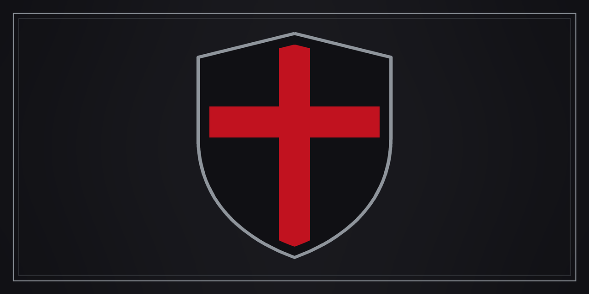
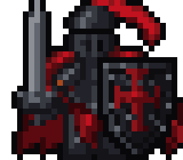

  

<h1 align="center">Blackshield Company</h1>

<strong>An independent studio. Local-first software, built to hold.</strong>

<em>To better ourselves, each other, and AI, under God.</em>

  

  <a href="https://blackshield-company.pages.dev">Studio site</a> ·
  <a href="https://github.com/sponsors/synthalorian">Sponsor</a> ·
  <a href="https://ko-fi.com/synthalorian">Ko-fi</a> ·
  <a href="mailto:blackshield@mail.grokbot.com">Contact</a>

---

## What we build

Open-source tools for developers, defenders and players. They run on your machine. Most need no account and no cloud.

### OpenShield
An AI coding harness and the clients around it. Terminal first, your own keys or local models.

| Repo | What it is |
|---|---|
| [openshield](https://github.com/Blackshield-Company/openshield) | The harness. Rust, TUI, learns from your sessions. |
| [openshield-desktop](https://github.com/Blackshield-Company/openshield-desktop) | Desktop app. Sessions, streaming chat, tool approvals. |
| [openshield-mobile](https://github.com/Blackshield-Company/openshield-mobile) | Android client. Pair over LAN. |
| [openshield-extension](https://github.com/Blackshield-Company/openshield-extension) | Firefox and Chrome remote. Send pages and selections into a session. |

### Tools
| Repo | What it is |
|---|---|
| [sentryclaw](https://github.com/Blackshield-Company/sentryclaw) | Code review bot you host yourself. Local models, no cloud, no API keys. |
| [wireclaw](https://github.com/Blackshield-Company/wireclaw) | Local HTTP proxy for API traffic. Capture, replay, inspect. |
| [shieldwall](https://github.com/Blackshield-Company/shieldwall) | Paste your setup, get a hardening checklist. |
| [bounty-mcp](https://github.com/Blackshield-Company/bounty-mcp) | MCP server that searches paid bounties on GitHub and Opire. |

### Identity
| Repo | What it is |
|---|---|
| [blackshield-site](https://github.com/Blackshield-Company/blackshield-site) | The studio site. |
| [blackshield-knight-sprite](https://github.com/Blackshield-Company/blackshield-knight-sprite) | The Blackshield Knight. Black heater shield, red plume, procedural sprite atlas. |

## More from the studio

Games, audio, forensics tools and Skyrim SE/AE mods. The mods are free on [Nexus Mods](https://www.nexusmods.com/skyrimspecialedition/users/synthalorian); source is here.

- [voidengine](https://github.com/Blackshield-Company/voidengine), [voidengine-level-editor](https://github.com/Blackshield-Company/voidengine-level-editor) and [void-mercs-demo](https://github.com/Blackshield-Company/void-mercs-demo)
- [kicks](https://github.com/Blackshield-Company/kicks) and [Open-Amp](https://github.com/Blackshield-Company/Open-Amp), plus [open-synth](https://github.com/synthalorian/open-synth)
- [custody](https://github.com/Blackshield-Company/custody), [docket](https://github.com/Blackshield-Company/docket), [timeline](https://github.com/Blackshield-Company/timeline), [beacon](https://github.com/Blackshield-Company/beacon) and [exifguard](https://github.com/Blackshield-Company/exifguard)
- Skyrim mods: [blackshield-company](https://github.com/Blackshield-Company/blackshield-company), [contract-hunter](https://github.com/Blackshield-Company/contract-hunter), [steel-oath](https://github.com/Blackshield-Company/steel-oath) and more

---

## Support the work

Everything above is free. If it saves you time, you can back the next release.

- [GitHub Sponsors](https://github.com/sponsors/synthalorian)
- [Ko-fi](https://ko-fi.com/synthalorian)

A star, a bug report or a fix helps just as much.

## Contact

[blackshield@mail.grokbot.com](mailto:blackshield@mail.grokbot.com)

For bugs, open an issue on the repo it belongs to.

Blackshield Company · Steel over spectacle.

